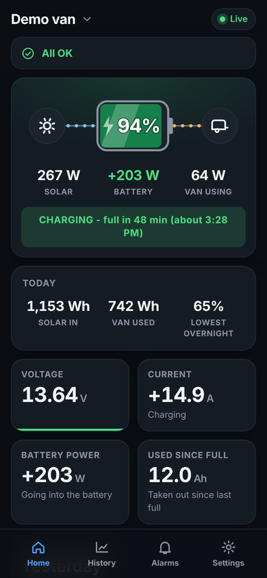
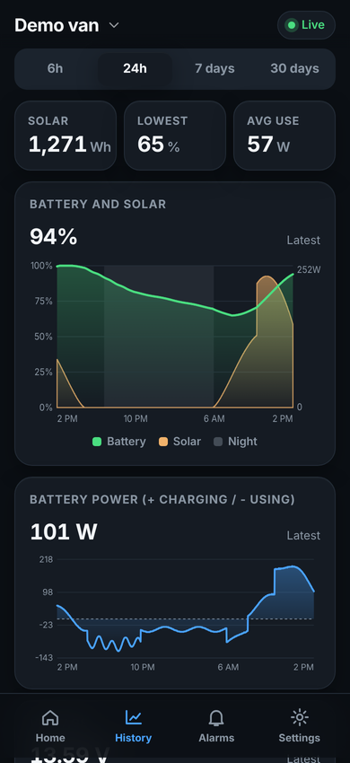
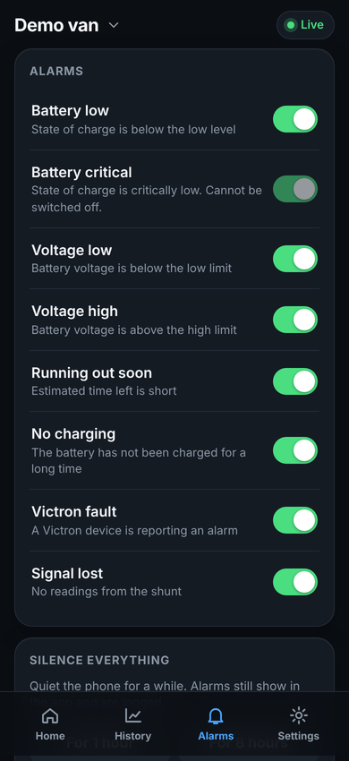
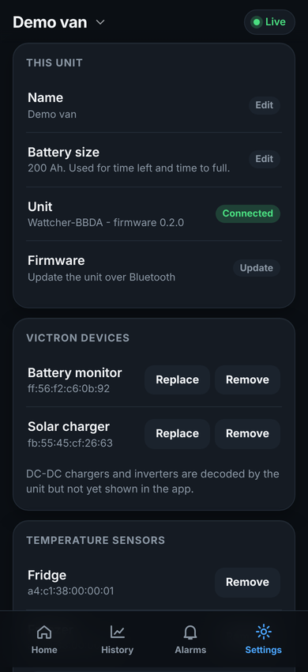

# Wattcher

A small ESP32 box with no screen, plus an Android app, that watches your Victron SmartShunt/BMV and SmartSolar MPPT
over Bluetooth and keeps the history for you. Plug it into USB power in the van, add your Victron keys in the app,
and see state of charge, time left or to full, solar, history graphs and alarms. Apache-2.0.

   

## What you need
- ESP32-C3 SuperMini (about $5), any USB power
- A Victron SmartShunt/BMV and/or SmartSolar MPPT with Instant Readout on
- An Android phone

## Install
1. Flash `wattcher-c3-factory.bin` from the [latest release](https://github.com/tubby2727/Wattcher/releases/latest) at address 0x0 (https://espressif.github.io/esptool-js/ works from Chrome; use Erase Flash first on a used board).
2. Install `wattcher.apk` from the same release (allow installs from your browser). Set Wattcher's battery usage to Unrestricted so alerts keep working in the background.
3. Open the app and follow the setup. Power the unit and claim it within 5 minutes.

 Scan the QR code to open the download page on another phone, or use Settings, Share Wattcher in the app.
No Android? https://tubby2727.github.io/Wattcher/ runs the same app in Chrome using Web Bluetooth.

Problems? See [docs/troubleshooting.md](docs/troubleshooting.md).

## Features
Animated power flow, battery %, time to empty/full with a finish time, Today (Wh), history up to 30 days kept on the unit, night-shaded graphs, alarms with loud repeating notifications and silence options, Android home-screen widgets, optional temperature sensors, several saved vans, firmware updates over Bluetooth.

## Layout
- `firmware/` PlatformIO. `lib/victron` decoder, `lib/core` alarms/history/claim, host tests in `firmware/test`.
- `app/` Vite + Capacitor app (`npm run sync` builds, `scripts/patch_android.py` configures Android and adds the widgets).
- `docs/` protocol, Victron notes, troubleshooting.

## Releasing
Bump `app/package.json`, then push to the `release` branch (or push a `vX.Y.Z` tag). The release workflow builds the APK and firmware and attaches `wattcher.apk`, `wattcher-c3-app.bin` (for in-app updates) and `wattcher-c3-factory.bin`.
Signed APKs need repo secrets `ANDROID_KEYSTORE_BASE64`, `ANDROID_KEYSTORE_PASSWORD`, `ANDROID_KEY_ALIAS`, `ANDROID_KEY_PASSWORD`; without them the APK is debug-signed and cannot update over a previous install.

Never commit Victron encryption keys. Battery-monitor and solar decoding are verified on real hardware; Orion, inverter and Battery Sense decoders and temperature sensors are experimental.
